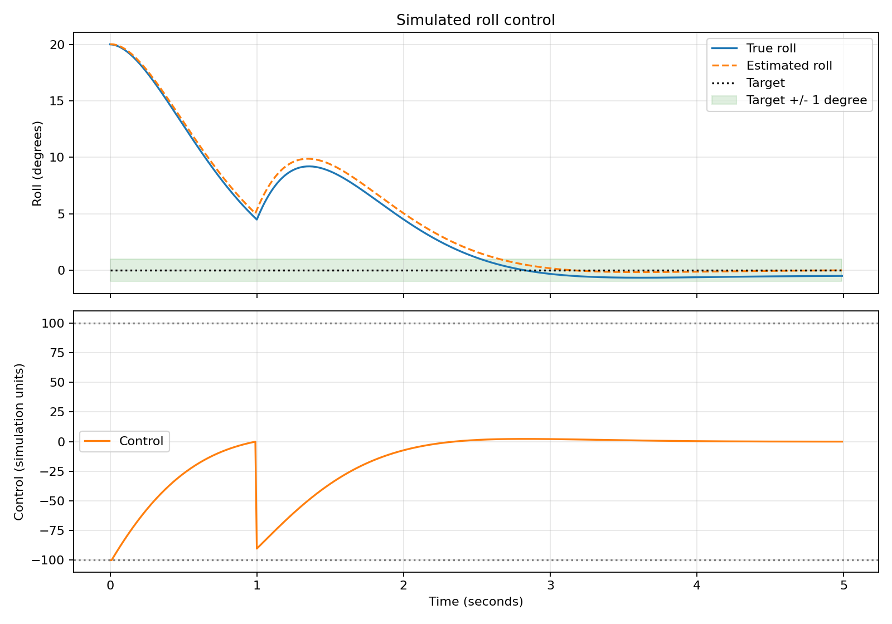
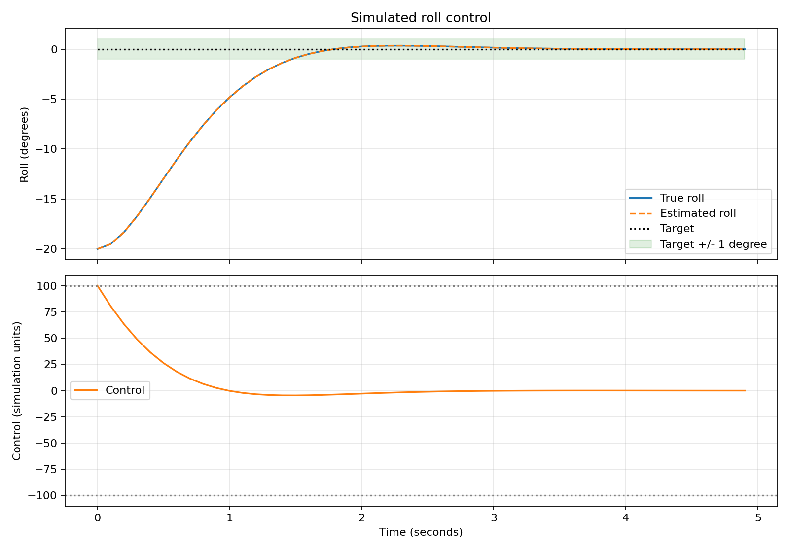

# Flight-controller engineering log

This is the running write-up for the flight-controller work. Keep explanations, implementation details and measured results together as development proceeds. The wider system remains described in [architecture.md](architecture.md), with aircraft targets in [requirements.md](requirements.md).

## 2026-10-12: Hardware-independent C foundation and PID tests

### Evidence and current status

This entry records the source inspected in Marc's local CLion checkout at `software/flight-controller/` and a fresh host build and test run. At the time of inspection, that directory was untracked locally and absent from GitHub's `main` branch. This documentation change does not publish those source files. The paths below describe the local implementation; a fresh clone needs the source added before these build instructions can run.

The earlier development conversation reported passing PID tests. This entry independently verifies the local implementation, including the integral and derivative assertions. It records the current foundation, not a completed flight controller or a validated aircraft.

### Why start without hardware?

The first objective is to test the control mathematics on the development computer before adding sensor buses, embedded timing and motor outputs. C keeps the algorithm suitable for later embedded use, while a host executable gives short build and test cycles. The PID accepts numbers supplied by its caller and has no sensor or motor dependencies.

Separating reusable control logic from hardware interfaces lets the same algorithm be exercised with test inputs and, later, simulated or measured inputs. It does not yet establish real-time performance on a microcontroller.

### CLion and CMake structure

The local source layout is:

```text
software/flight-controller/
├── CMakeLists.txt
├── include/
│   ├── pid.h
│   ├── attitude.h
│   ├── simulated_imu.h
│   └── mixer.h
├── src/
│   ├── main.c
│   ├── control/pid.c
│   ├── estimation/attitude.c
│   ├── simulation/simulated_imu.c
│   └── mixer/mixer.c
└── tests/test_pid.c
```

`CMakeLists.txt` requires CMake 3.20 or newer, names the project `drone_flight_controller`, and requires C11. It defines two executables:

| Target | Sources and purpose |
|---|---|
| `drone_sim` | `main.c`, PID, attitude, simulated IMU and mixer source files. Currently only prints a startup message. |
| `test_pid` | `tests/test_pid.c` and the same `src/control/pid.c` used by `drone_sim`. Exercises the actual PID implementation. |

Both targets use `include/` as a private header search directory and link the math library `m` in the current host configuration. `enable_testing()` and `add_test(NAME pid_tests COMMAND test_pid)` register one CTest test. That one executable contains several assertions.

The attitude, simulated IMU and mixer headers and source files are currently empty placeholders. There is no dynamics model, attitude estimator, motor mixing or closed control loop yet, despite the `drone_sim` name.

Open `software/flight-controller/` as a CMake project in CLion. Use a Debug profile, build `drone_sim` or `test_pid`, and run the test target or CTest. CLion's `cmake-build-debug/` directory holds generated files, not source. A command-line equivalent, once the local source is available, is:

```sh
# From the repository root, with CMake on PATH:
cmake -S software/flight-controller -B software/flight-controller/cmake-build-debug -DCMAKE_BUILD_TYPE=Debug
cmake --build software/flight-controller/cmake-build-debug
ctest --test-dir software/flight-controller/cmake-build-debug --output-on-failure
```

CLion can use its bundled CMake and CTest when they are not on the shell's PATH. Keep assertions enabled: these tests use C `assert`, which a build defining `NDEBUG` disables.

### PID implementation

`include/pid.h` defines a `PID` structure containing `kp`, `ki`, `kd`, `integral` and `previous_error`, all stored as `float`. Its interface is:

```c
void pid_init(PID *pid, float kp, float ki, float kd);
float pid_update(PID *pid, float setpoint, float measurement, float dt);
```

`pid_init` stores the gains and resets both history values to zero. Each `pid_update` performs:

```text
error = setpoint - measurement
integral = integral + error × dt
derivative = (error - previous_error) / dt, if dt > 0
previous_error = error
output = kp × error + ki × integral + kd × derivative
```

Integration adds the area under the error-versus-time curve. The implementation approximates this with a rectangular step using the current error. Differentiation estimates the slope from two successive error samples. `dt` must be the elapsed time in seconds between updates for the examples below. Gains must match the chosen input and output units; the output is a correction quantity, not automatically a motor speed or thrust.

The derivative starts from a previous error of zero, so a nonzero first error produces a derivative response. For `dt <= 0`, the code sets the derivative to zero but still updates the integral and previous error. It does not reject invalid timing; callers should supply a positive elapsed time.

### What P, I and D mean for a drone

Roll tilts the aircraft sideways about its longitudinal axis. Pitch tilts the nose up or down about its lateral axis. Yaw turns its heading about its vertical axis. Each controlled axis needs its own PID state so one axis's error history cannot affect another's.

For an illustrative roll-angle controller, let the desired roll be 0 degrees and measured roll be +10 degrees. With `error = setpoint - measurement`, the error is -10 degrees. A negative correction should produce a restoring roll torque once the sensor and motor sign conventions are defined. The same mathematics applies to pitch and yaw, but each axis needs suitable gains and actuator mapping.

#### Proportional: respond to the current error

`P = kp × error`. With `kp = 2` and error -10, the proportional contribution is -20 correction units. As the drone approaches its target angle, the proportional contribution shrinks.

A constant disturbance, such as a centre-of-gravity offset or unequal thrust, can require a sustained correction. A proportional-only loop may settle with a nonzero error because that error supplies the correction balancing the disturbance. Increasing the gain can reduce the offset but can also increase oscillation.

#### Integral: accumulate persistent error

`I = ki × integral`, where `integral += error × dt`. If the aircraft stays at +2 degrees while the target is zero, its error is -2. At 0.1-second intervals the integral becomes -0.2, -0.4, -0.6 degree-seconds, and so on.

This builds the sustained correction needed to counter a persistent disturbance. In a suitably tuned, stable loop with sufficient actuator authority, it can remove steady-state error. It remembers signed error over time, not merely how long the aircraft has been tilted. Opposite-signed errors can cancel.

If the requested correction exceeds what the motors can deliver, the integral can keep growing. This is integral windup. Output limiting and anti-windup remain future work.

#### Derivative: respond to how fast the error changes

`D = kd × (error - previous_error) / dt`. With a fixed target, this term responds to motion toward or away from that target. If an error falls from +10 to +5 in 0.1 seconds, its slope is -50 units per second. With `kd = 1`, the derivative contribution is -50.

For that example, P is still positive while D is negative. D can reduce the correction as the aircraft approaches the target quickly, helping damp overshoot. It is an estimate of recent change, not a prediction of future motion.

Differentiation also amplifies measurement noise. This implementation differentiates error, so a sudden setpoint change produces a derivative kick. Filtering and a possible derivative-on-measurement design need consideration before sensor-driven use.

#### Connecting the mathematics to flight control

The current PID has no knowledge of angles, angular rates or aircraft geometry. An angle loop would compare desired and measured angle; a rate loop would compare desired and measured angular velocity. A common future approach is an outer angle loop that requests a rate and an inner rate loop that requests a torque correction. That architecture is not implemented here.

A future mixer must turn roll, pitch and yaw corrections, together with collective thrust, into individual motor commands. Yaw heading errors also need angle wrapping at the chosen heading boundary. Simple subtraction can otherwise turn a small boundary-crossing error into a nearly full-turn error. Neither wrapping nor motor mapping is part of the current PID.

The numeric gains in the examples explain arithmetic. They are not tuned flight gains.

### Tests and results

`tests/test_pid.c` compares floating-point results with `fabsf(a - b) < 0.0001f`. Each scenario reinitializes the controller and isolates the term under test.

| Scenario | Inputs | Expected result |
|---|---|---|
| Zero error | `kp=1`, `ki=kd=0`; setpoint and measurement zero | Output 0 |
| Proportional | `kp=2`, `ki=kd=0`; setpoint 10, measurement 7 | Output 6 |
| Integral accumulation | `ki=1`, `kp=kd=0`; error 10, `dt=0.1`, two updates | Outputs 1 then 2 |
| Derivative change | `kd=1`, `kp=ki=0`; establish error 10, then error 5, each with `dt=0.1` | Second output -50 |

The derivative test deliberately establishes history first. Its first output is not asserted; with this initialization it would be 100. The second assertion checks the change between the two samples.

Verification on 2026-10-12 used CLion's bundled CMake/CTest and AppleClang 21.0.0 on macOS, with a fresh Debug build directory outside the source checkout. Both targets built successfully. CTest reported:

```text
1/1 Test #1: pid_tests ... Passed
100% tests passed, 0 tests failed out of 1
```

Running `drone_sim` printed `Drone flight controller simulation running.` These results establish the four arithmetic scenarios above. They do not demonstrate aircraft stability, sensor handling, saturation behaviour or a functioning simulation.

### Next work and maintaining this record

Publish the local source separately so a fresh clone can reproduce the build. Next control improvements are output limits and integral anti-windup with tests that exercise saturation and recovery. Further work includes explicit timing behaviour, derivative noise handling, a simulated plant and axis sign conventions before connecting real sensors or actuators.

For each subsequent milestone, append a dated entry with the problem, changed files or commit, reasoning, exact verification procedure, observed results, limitations and next step. Distinguish proposed behaviour from implemented behaviour. Link the relevant pull request or experiment once available, and update older descriptions when the current implementation changes while retaining their dated results.


## 2026-10-12: Closed-loop tests and baseline roll-response plot

The controller sources are now committed. The project includes a single-axis dynamics model, simulated IMU, complementary attitude estimator, bounded PID control and CSV plotting. A fresh Debug rebuild on 12 October passed all five CTest suites: PID, simulation, attitude, IMU and closed-loop control.


The supplied image and accompanying local CSV record the earlier baseline run starting at -20 degrees with a zero-degree target. The CSV contains samples every 0.1 seconds from 0.0 to 4.9 seconds; its last recorded true and estimated roll values are both -0.005 degrees at the exported precision. The baseline controller uses Kp=5, Ki=0, Kd=2, a 0.01-second simulation step and control limits of -100 to +100 simulation units. This image is baseline evidence, not evidence of the later disturbance and bias demonstration. Its generating source revision was not captured with the export.

### Verification limits and next corrections

The current closed-loop executable includes seven scenarios covering initial roll, signed disturbances and signed gyro bias. Although all scenarios pass, inspection found that the test applies the disturbance twice and lacks the proposed final-second estimation-error assertion. In the demonstration, gyro bias is added to a sample after the estimator update, then overwritten by the next iteration's fresh sample; the estimator therefore does not receive that bias. Correct the operation order and test assertions, rerun the suites, then regenerate separately labelled baseline and disturbed/bias plots.

These results concern the simplified host simulation only. They do not establish hardware or flight performance.


## 2026-10-12: Additional roll-response exports

These two supplied images are preserved under their original filenames. Their adjacent local CSV files were inspected before publication. The filenames do not reliably identify the scenarios; the descriptions below follow the recorded data. These exports do not establish a before/after calibration comparison, and their generating source revisions were not recorded.

### Export named `roll-calibrated.png`



The CSV contains 500 samples from 0.00 to 4.99 seconds, at 0.01-second intervals. True roll starts at +20 degrees, with a zero-degree target. A disturbance response is visible around one second. At the final sample, true roll is -0.503546 degrees and estimated roll is -0.013427 degrees, giving an estimated-minus-true error of +0.490119 degrees. The response is consistent with the earlier +45 degrees/second disturbance and +1 degree/second uncorrected gyro-bias scenario. Despite its filename, this export does not demonstrate successful bias removal.

### Export named `roll-disturbed-bias.png`



The CSV contains 50 samples from 0.00 to 4.90 seconds, at 0.10-second intervals. True and estimated roll start at -20 degrees and finish at -0.005 degrees at the exported precision, with a zero-degree target. The image shows baseline recovery rather than the intended disturbed, biased run. It should not be cited as disturbance or gyro-bias validation.

### Follow-up

Rebuild the intended simulation executable before exporting again. Capture matched uncalibrated and calibrated runs with the same initial angle, disturbance, bias, controller gains and timestep. Confirm the measured calibration offset and record the source revision and run settings with the new evidence. Retain these original exports as part of the engineering history.

## 2026-10-12: Motor mixing, motor-driven dynamics and vertical simulation

### Objective

The previous simulation allowed the PID controller to apply an abstract roll-control value directly to the simulated aircraft.

Although useful for validating the PID and attitude estimator, this skipped an important part of a real quadcopter flight-control system: converting control requests into individual motor commands.

This milestone introduced a Quad-X motor mixer and changed the simulation so aircraft motion can be produced by four motor outputs.

### Quad-X motor mixer

The flight controller now defines four normalized motor outputs:

```text
              FRONT

        M1             M2
   Front Left     Front Right
      CCW              CW


        M4             M3
    Rear Left      Rear Right
       CW              CCW
```

The mixer accepts:

- collective throttle
- roll correction
- pitch correction
- yaw correction

and produces four normalized motor outputs.

Motor commands are limited to the range:

```text
0.0 <= motor output <= 1.0
```

Although the mixer supports roll, pitch and yaw inputs, the current aircraft dynamics model only implements roll.

### Motor-driven roll simulation

The original roll simulation accepted a single abstract control input.

The new simulation determines roll torque from the difference between the combined left and right motor outputs.

Conceptually:

```text
left output =
    front-left + rear-left

right output =
    front-right + rear-right

roll torque =
    left output - right output
```

The simulated angular acceleration is then calculated from the motor imbalance and an existing roll-damping term.

The motor torque scaling constant is currently a simulation parameter. It has not been derived from measured motor thrust, arm length or aircraft moment of inertia.

### Closed-loop integration

The roll-control path now passes through the same major stages expected in the eventual aircraft:

```text
IMU measurement
      ↓
attitude estimation
      ↓
PID controller
      ↓
roll command
      ↓
Quad-X mixer
      ↓
four motor outputs
      ↓
aircraft dynamics
```

The PID output is scaled before entering the normalized mixer.

With the current simulation constants, this scaling was chosen so the motor-driven plant preserves approximately the same control authority as the previous direct-control simulation.

Existing closed-loop recovery tests were retained to ensure the architectural change did not break the previously demonstrated stabilization behavior.

### Vertical dynamics

The simulated aircraft state was extended with:

```text
altitude
vertical velocity
```

The current sign convention treats positive altitude and vertical velocity as upward.

Vertical acceleration is calculated using Newton's second law:

```text
acceleration = force / mass
```

with gravity subtracted from total motor thrust:

```text
vertical acceleration =
    total thrust / aircraft mass
    - gravitational acceleration
```

The current simulation constants are:

```text
aircraft mass       = 1.0 kg
gravity             = 9.81 m/s²
maximum motor thrust = 4.905 N per motor
```

For four motors at 50% output:

```text
total thrust
= 4 × 0.5 × 4.905
= 9.81 N
```

The gravitational force on the simulated 1 kg aircraft is also 9.81 N.

Therefore:

```text
0.5 throttle → approximately zero vertical acceleration
```

for a level aircraft in the current model.

This provides a convenient nominal hover point for subsequent altitude-control development.

### Vertical simulation tests

Additional simulation tests verify that:

- 50% equal motor output produces no vertical acceleration
- zero motor output causes downward acceleration
- full motor output causes upward acceleration
- a pure roll command around 50% throttle preserves total thrust
- zero timestep leaves roll and vertical state unchanged

These tests validate the current equations rather than real aircraft performance.

### Important limitations

The vertical model currently assumes all motor thrust acts in the vertical direction.

This is only correct while the aircraft is level.

When an aircraft rolls or pitches, its thrust vector tilts. The vertical component should therefore decrease approximately according to the attitude of the aircraft.

For a roll-only approximation:

```text
vertical thrust ≈ total thrust × cos(roll)
```

A complete model would resolve the thrust vector using both roll and pitch and use the remaining horizontal component to calculate translational acceleration.

Other effects not currently modeled include:

- aerodynamic drag
- motor response time
- propeller dynamics
- ground contact
- battery voltage changes
- aircraft moment of inertia
- measured thrust curves
- sensor vibration and noise

The present simulator should therefore be treated as a control-development tool rather than a high-fidelity physics model.

### Current milestone

At this point the project has demonstrated a complete simulated roll-control path from sensor measurement to individual motor commands, while also establishing a basic vertical-motion model.

The software remains hardware independent and can continue to be exercised on the development computer before the STM32H753 hardware layer is introduced.

### Next steps

The next major control milestone is altitude control.

Instead of using a fixed throttle value, an altitude controller will compare:

```text
target altitude
        ↓
altitude error
        ↓
altitude PID
        ↓
collective throttle
```

The resulting collective throttle can then be combined with roll, pitch and yaw corrections by the existing Quad-X mixer.

Before relying on altitude behavior for more realistic simulation, the model should also account for loss of vertical thrust while the aircraft is tilted.
